# Principle-Level Collapse Benchmark

## Installation and readiness

The core recorder, CLI and decision logic use Python's standard library.
Network scoring additionally needs NumPy. Molecules need RDKit, PyTDC and the
existing oracle assets; molecular metrics need pymoo. 
Starter dependency lists are `benchmark/requirements-network.txt`
and `benchmark/requirements-molecules.txt`. 

```bash
python -m unittest discover -s benchmark/tests -v
```

## Complete example: random ZINC search

From the repository root, in an environment with the molecular dependencies installed:

```bash
python -m benchmark.examples.random_zinc \
  --seed 42 --budget 200 --batch-size 25 \
  --output outputs/random_zinc/42_smoke
```

This runs the complete proposal -> five-objective evaluation -> recording ->
diagnosis -> plotting pipeline, without an LLM or API key. It randomly samples
SMILES without replacement.
The first run downloads about 22 MB to `~/.cache/exllm/zinc250k.csv`; later runs reuse it.
Use `--zinc-csv /path/to/zinc.csv` for a local CSV with a `smiles` column.
The existing `data/zinc.tab` is an HTML error response and is not used.

The first 100 sampled rows are initialization. The command saves `attempts.jsonl`,
`diagnosis.json`, `report.md`, `convergence.png`, and `early_late.png` in the output
directory. The 200-evaluation example is a **smoke test, not a full-budget collapse
experiment**; early/late 1000-attempt windows overlap in such a short run.
For the full molecular budget, use a new output directory:

```bash
python -m benchmark.examples.random_zinc \
  --seed 42 --budget 5000 --batch-size 50 \
  --output outputs/random_zinc/42_full
```

Random ZINC search is only an integration example, not a feedback-driven LLM
optimizer. Replace its `propose`/`observe` methods with your optimizer to reuse
the same evaluation and reporting interface. Existing run directories are never overwritten.

## Selected benchmark results


### Diagnosis decision tree

Combine reference gaps, principle narrowing, and performance plateaus; candidate-level diversity alone is not enough.

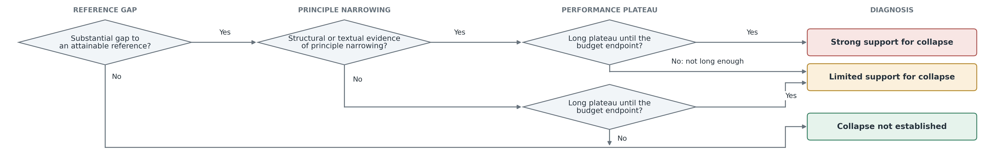

Full decision tree, including the eligible principle-text audit

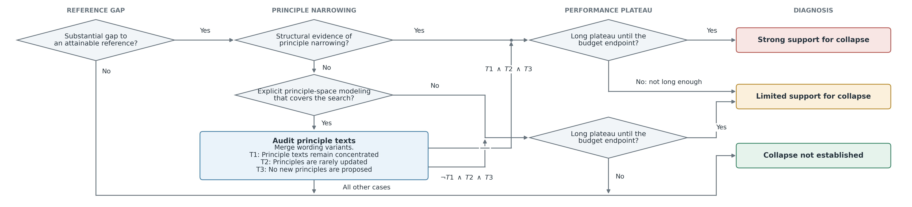

### Convergence across three domains

Performance and effective scaffold/node/route counts reveal different aspects of search.

**Molecular optimization**

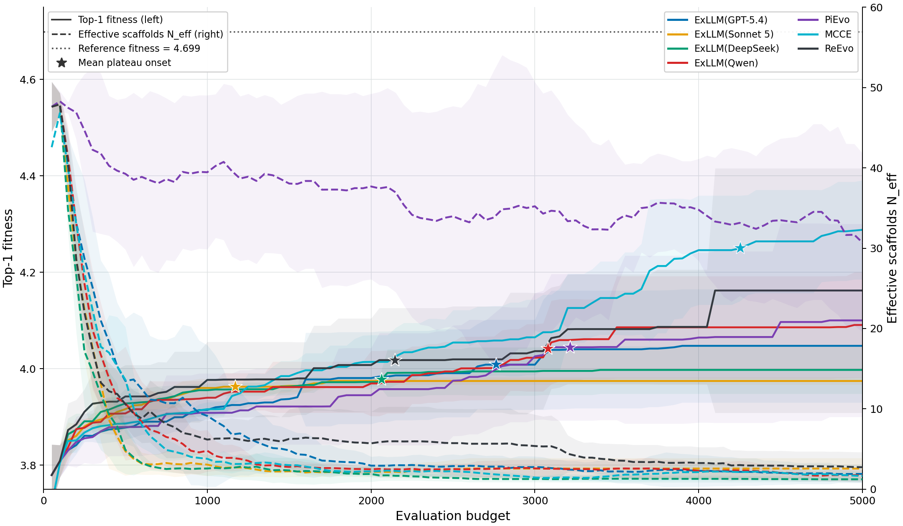

**Network sentinel-node selection: residence hall**

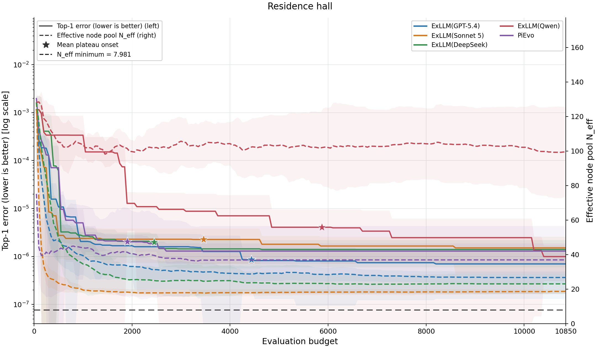

**GPU-kernel optimization**

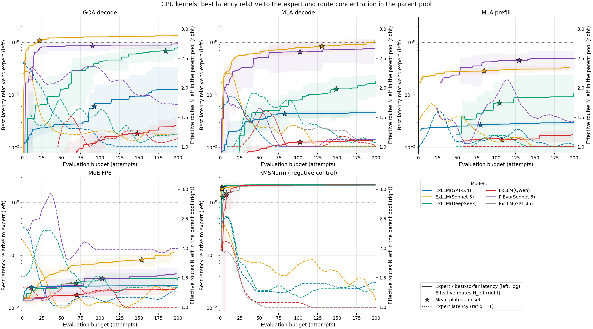

### Early versus late search

Molecular and network bars use outlined bars for early search and filled bars for late search;
scaffold counts and effective scaffold counts are divided by 50, and effective node
counts by network size (62 or 217). Kernel bars label early/late stages separately.

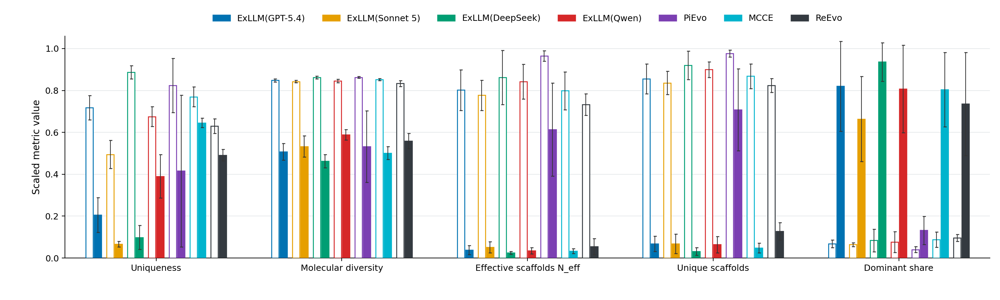

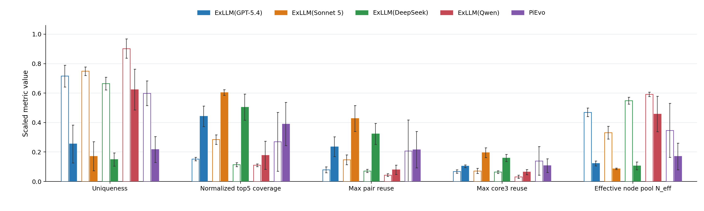

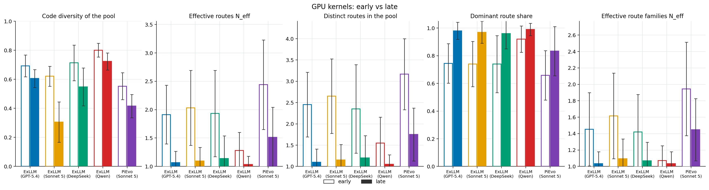

Dolphin: convergence and early/late comparison

Dolphin provides a simpler task with an exhaustive optimum, helping distinguish harmful collapse from successful convergence.

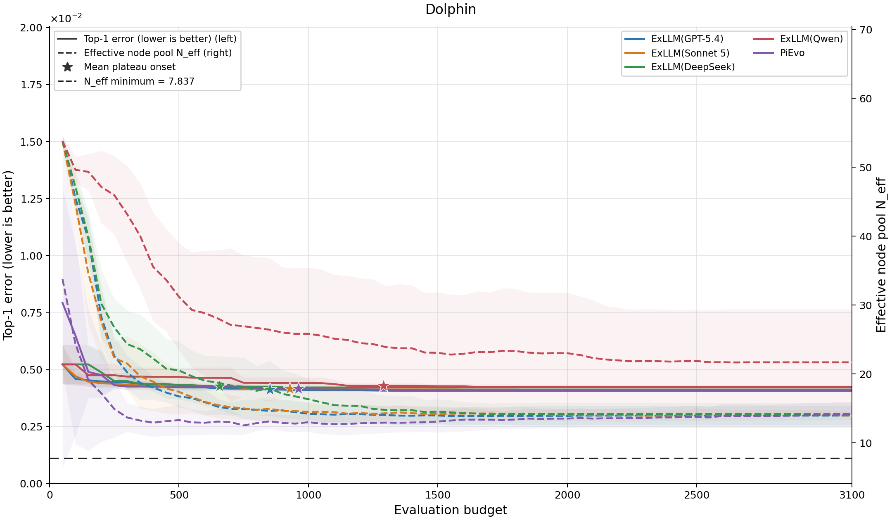

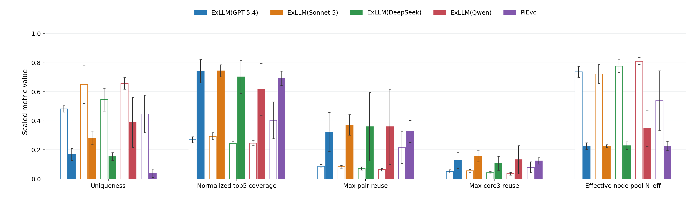

## Diversity injection

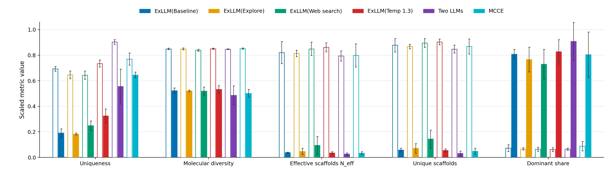

## Molecular reference-principle interventions

Better directions help some models, but do not guarantee effective use.

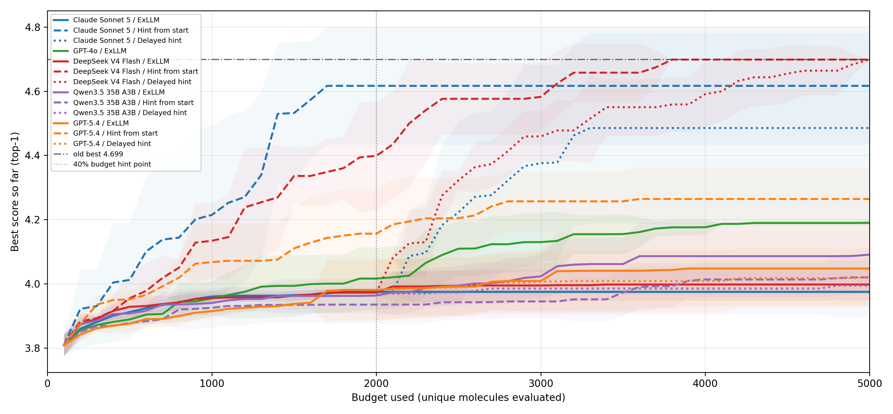

## Network data and attribution

The two network-dynamics arrays used by this benchmark are bundled in
`data/dynamic_system/fullstates/`:


| Task           | Dynamics        | NumPy file                             |
| -------------- | --------------- | -------------------------------------- |
| Dolphin        | Double-well     | `fullstate-dolphin-doublewell.npy`     |
| Residence hall | Gene regulation | `fullstate-residence_hall-genereg.npy` |


The task and dynamics data follow **Observing network dynamics through sentinel
nodes**. The underlying network data source is
[Netzschleuder: the network catalogue](https://networks.skewed.de/).

The benchmark loads these arrays by default, `data/dynamic_system/manifest.json` records their shapes and SHA256 hashes.
Use the following command to test the dolphin problem

```bash
python -m benchmark.examples.random_network --task dolphin --output outputs/dolphin_single_test --steps 100
```

To use another converted data directory, pass `data_dir=...` to `load_task` or
`--data-dir` to the example. The optional
`python -m benchmark prepare-network-data --source SOURCE --destination DESTINATION`
command validates and stages the same two arrays from `SOURCE/fullstates/`.

## Connect your optimizer

**full example in** `benchmark/examples/random_network.py & random_zinc.py`

```python
from benchmark import BenchmarkRun, load_task

task = load_task("molecules", seed=42)
run = BenchmarkRun(task, "outputs/my_method/42", optimizer="my-method")
initial = run.evaluate(task.initial_population(), phase="initialization")
# my_optimizer.observe(initial)
while run.budget_used < task.protocol["budget"]:
    candidates = my_optimizer.propose()
    results = run.evaluate(candidates)
    my_optimizer.observe(results)
run.finish("budget")
```

Use your own stopping guard for low uniqueness, because your algorithm may have very low uniqueness at a certain stage which may cause you huge amount of money and time to consume all the budget but results are not better. `evaluate` returns only the
processed prefix if a batch reaches the budget; it raises `BudgetExhausted` if
already exhausted. Invalid and duplicate proposals are recorded, not discarded.
Duplicates return cached scores. Backend failures propagate, rather than being
misreported as invalid candidates. Runs are single-writer, sequential evaluators.

Initialization counts toward evaluation budget. `resume=True` restores recorder
history, duplicate cache and counters, NOT your optimizer/RNG/LLM state. Restore
those yourself. Do not mix old and changed metadata in one run directory.

Network tasks default to `data/dynamic_system/`; `data_dir=...` overrides it.
Nodes are distinct integers, unordered,
one-indexed; weighted variants are outside this protocol.

## Diagnose and aggregate

```bash
python -m benchmark report outputs/my_method/42 --audit benchmark/examples/no_principle_model.json --plots
python -m benchmark summarize outputs/my_method/42 outputs/my_method/43 --output outputs/summary.csv
```

Artifacts: `metadata.json`, `attempts.jsonl`, optional `principles.jsonl`,
`termination.json`, then `diagnosis.json` and `report.md`. Summary CSV reports
sample SD only when at least two seeds are present. Different protocols are
grouped separately. Unassessable runs are excluded from support-rate denominators.
`--plots` additionally writes per-run convergence and early/late PNGs (matplotlib).
These are individual-run plots, not five-seed uncertainty plots. Legends stay
inside axes. Curves stop at the observed endpoint; the x-axis shows planned budget.

Any optimizer can instead export this schema directly. `report` validates
attempt ordering, identity/duplicate flags, and budget accounting. Valid records
need `fitness` (higher is better), `objectives` (raw), and `min_objectives` (the
existing minimized objectives). All attempts, including invalids, must be logged.
Use the recorder example to see the exact schema. Kernel rows require raw `objectives.latency` in milliseconds;
network rows require `objectives.error`.

## Metrics and diagnosis

Protocol values are frozen in `benchmark/configs/*.json` as **benchmark-v1**, an explicit
public-interface protocol. Always archive the resolved protocol alongside a run.

- Uniqueness = 1 - duplicate attempts / all attempts (invalids remain in the
denominator, matching ExLLM); validity = valid attempts / all attempts.
- Early/late attempt windows are first/last 1000 generated attempts; shorter
windows report their actual count and may overlap.
- Diagnostic metrics are computed on each optimizer’s own top-50 candidate set after initialization (early) and at the end of the run (late).
- Plateau onset is the earliest best-so-far point whose total subsequent observed
improvement is within epsilon, not just one flat step. Molecules: 0.01 fitness;
networks: 1% of the error at that point; kernels: 10% of its expert latency gap.
- Long plateau means at least 30% of planned budget remains at Plateau onset. 
- Large gap: molecular top1 < 4.3; network/kernel error or latency >= 2x reference.
References are best-known attainable results, except exhaustive Dolphin.
- Structural narrowing: molecular N_eff <= 3; network N_eff <= 4 times the
50-distinct-set lower bound (7.837115314 / 7.981300322); kernel route N_eff <= 2.
Changing selection size requires new calibrated thresholds, not these defaults.


## Text audits and kernel annotations

The no-principle-model example explicitly declares ineligibility; ordinary
experience memory alone does not qualify as a covering principle-space model.
Eligible algorithms must supply a reviewed `text_audit.json`. Merge wording
variants into semantic routes and weight actual usage over the last 1000 attempts.
T1: dominant route >= 50%; T2: <=5 minor updates, zero major updates; T3: zero
newly proposed directions (including unadopted directions). Reviewer and source
evidence are mandatory. For eligible models, T1+T2+T3 gives narrowing; otherwise only !T1+T2+T3 with a
long plateau gives Limited support. Other fully audited cases are Not established.

Kernel reports accept `--labels routes.json`, a mapping from canonical source
keys to reviewed decomposition labels. Missing labels yield unknown structural
evidence. Live scoring wraps the existing official harness:

```python
task = load_task("kernel", protocol={"reference": expert_latency_ms},
                 evaluator_config={"problem_name": problem_name})
```

Set `SOL_EXECBENCH_ROOT` before importing the kernel adapter. You still need the
external SOL-ExecBench problem assets, compatible NVIDIA GPU, Docker and the
existing `sol-execbench:fixed` image. Expert references must match hardware and
workloads. 

---


# ExLLM

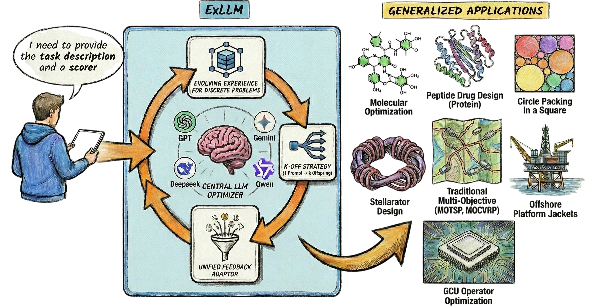
This repository contains the source code and scripts for the ExLLM project. The project is organized as follows:

## Results

ExLLM serves as a general LLM-as-optimizer framework and achieves strong performance across 7 heterogeneous domains:

### Results


#### **Practical Molecular Optimization (PMO)**

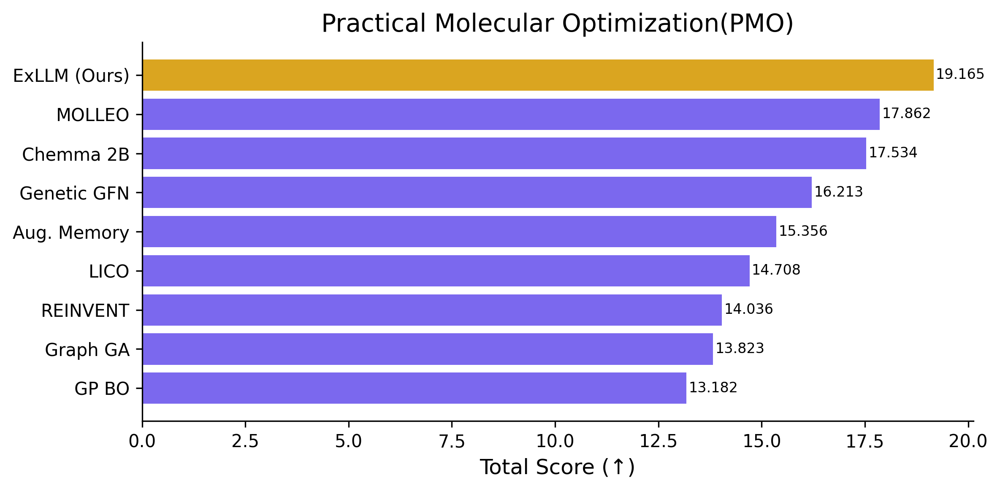 Also 2nd place in Molecular Generation Challenge 2025 hosted by Sinopec.

---


#### **Circle Packing in a Unit Square**


| n          | 26                        | 27                | 28                | 29                | 30                | 31                | 32                      |
| ---------- | ------------------------- | ----------------- | ----------------- | ----------------- | ----------------- | ----------------- | ----------------------- |
| **Record** | 2.635977 (AlphaEvolve)    | 2.685+ (Cantrell) | 2.737+ (Cantrell) | 2.790+ (Cantrell) | 2.842+ (Cantrell) | 2.889+ (Cantrell) | 2.937+ (AlphaEvolve)    |
| **ExLLM**  | **2.635983 (new record)** | 2.68598           | 2.73740           | 2.79034           | 2.84267           | 2.88997           | **2.939+ (new record)** |


---


#### **Stellarator Design, Constellation Benchmark**

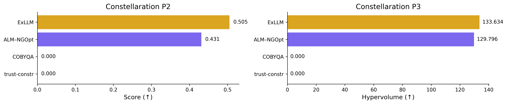

---


#### **Offshore Platform Jacket Structural Optimization**

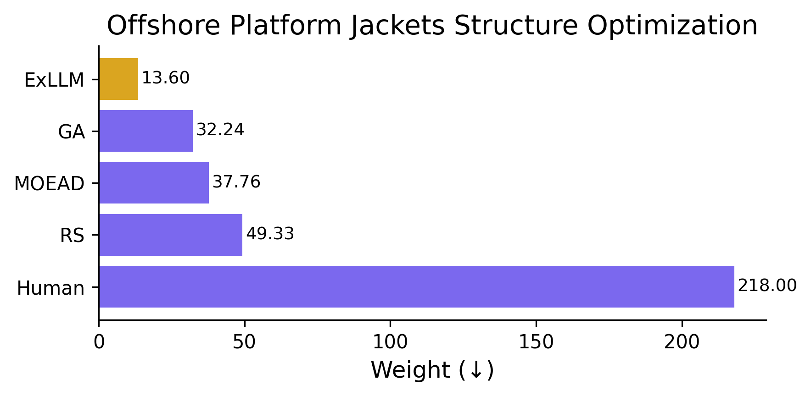

---


#### **Classical Multi-objective Routing (MOTSP / MOCVRP)**

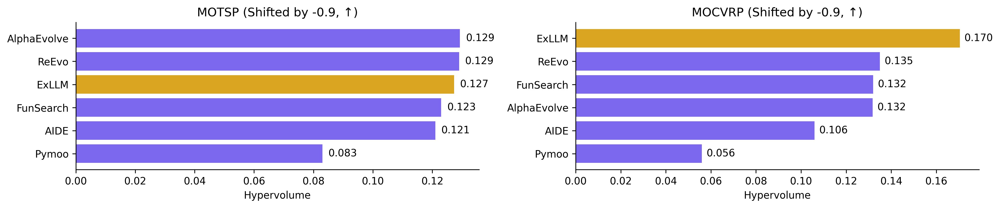

---


#### **GCU kernel optimization**

Tencent Kaiwu AI competition 2025 (GCU track), Second prize.

---


#### **Peptide Design**


### Running the experiments

- `python main.py molecules/goal5_gemini.yaml`: You need to define a config file to run, this is an example, you can use it as a template, the path is set to under the problem directory.
- To resume training, just set `resume: True` in your config file.


## Getting Started

To define a new optimization problem, you only need to create the following three files:

1. `config.yaml` – This file specifies the algorithm parameters for optimization.
  📁 Example: `problem/molecules/config.yaml`
2. `prompt_info.yaml` – This file contains metadata, problem definitions, and textual descriptions.
  A full tutorial is provided below.  
   📁 Example: `problem/molecules/prompt_info.yaml`
3. `evaluator.py` – This Python file defines how the generated solutions are evaluated.
  A full tutorial is provided below.  
   📁 Example: `problem/molecules/evaluator.py`


# 🧬 YAML File Specification for Multi-Objective Molecular Optimization

This project uses a structured YAML format to define tasks for multi-objective molecular optimization. Each YAML file outlines the task description, output format, mutation/crossover guidelines, and optimization objectives. This format ensures consistency and clarity when interfacing with molecule generation and optimization models.

---


## 📁 File Structure Overview

A standard YAML file should contain the following fields:


| Field Name                                 | Required | Description                                                                                 |
| ------------------------------------------ | -------- | ------------------------------------------------------------------------------------------- |
| `description`                              | ✅        | A brief overview of the task; describe what the model should achieve                        |
| `example_output`                           | ✅        | Defines the expected output format (must include `<candidate>` tags and your answer format) |
| `mutation_instruction`                     | ⭕        | Suggested mutation operations to guide molecule structure changes                           |
| `crossover_instruction`                    | ⭕        | Suggested crossover operations (optional, can be left empty)                                |
| `other_requirements`                       | ⭕        | Any additional constraints, e.g., "Molecules must be valid"                                 |
| Optimization Objectives (e.g. `qed`, `sa`) | ✅        | One or more task-specific objectives, each described in a dedicated field                   |


---


## 📝 Example YAML File (problem/molecules/molecule.yaml)

```yaml
description: This task is to propose better molecules according to multiple objectives.

example_output: 'Each output new candidate must start with <candidate> and end with </candidate> in SMILES format. Example: <candidate>c1ccccc1</candidate>'

mutation_instruction: 'Example operations include:
  1. Modify functional groups
  2. Replace atoms or bonds
  3. Add/remove small substituents
  4. Ring modifications
  5. Stereochemistry changes
  6. Property-specific optimizations
  '

crossover_instruction: ''

other_requirements: The output molecules should be valid.

qed: QED (Quantitative Estimate of Drug-likeness) is a measure that quantifieshow
  'drug-like' a molecule is based on properties such as molecular weight,solubility,
  and the number of hydrogen bond donors and acceptors.Adding functional groups that
  improve drug-like properties (e.g., small molecular size,balanced hydrophilicity)
  can increase QED, while introducing large, complex, or highly polar groups can decrease
  it.
logp: LogP is the logarithm of the partition coefficient, measuring the lipophilicityor
  hydrophobicity of a molecule, indicating its solubility in fats versus water.Adding
  hydrophobic groups (e.g., alkyl chains or aromatic rings) increases LogP,while adding
  polar or hydrophilic groups (e.g., hydroxyl or carboxyl groups) decreases it.
```


# 📊 Evaluator Guide

In each specific problem directory under `problem/`, you need to create an `evaluator.py` file to define a custom evaluation logic. This file should contain a class named `RewardingSystem` that evaluates the quality of generated results.

---


## ✅ Required Structure

The `evaluator.py` file **must** define the following structure:

```python
def generate_initial_population(config,seed):
    # Arbitrary initial population, in strings form. The format should be consistent to the output format
    # The config and seed will be passed, you can use it or not
    return samples

class RewardingSystem:
    def __init__(self, config):
        # Initialization method (config is passed in)
        pass

    def evaluate(self, items):
        # Main evaluation function
        return items, log_dict
```

---


## Generate initial population

You are free to define the initial population. Each candidate must be a string, and its format must be consistent with what your evaluator expects. It is assumed these strings can be parsed and evaluated by your `evaluate` method.

## 🧩 Input and Output of `evaluate`

- **Input**: `items` is a list of Item objects (algorithm.base.Item). Each dictionary represents a result item to evaluate.
- **Each item must be given a dict containing the following keys**:


| Key                   | Description                                                                                                |
| --------------------- | ---------------------------------------------------------------------------------------------------------- |
| `original_results`    | The raw metrics (e.g., `{'sa': 2.22, 'qed': 0.68}`). These are used for logging or visualization.          |
| `transformed_results` | The normalized and minimized version of the original results. Values must be in the `[0, 1]` range.        |
| `overall_score`       | A scalar value representing the overall quality of the item. Higher is better. This is fully customizable. |


- **Then simply use item.assign_results(results) to assign the result to each item**
- **If you want to change the value of an item, just use** `item.value=xxx`


### 🔸 Required Fields in `log_dict`

The `evaluate` function must return a second output: a dictionary called `log_dict` for tracking evaluation statistics. The following fields are **required**:


| Key            | Description                                                             |
| -------------- | ----------------------------------------------------------------------- |
| `invalid_num`  | Number of invalid candidates (e.g., failed parsing, wrong format, etc.) |
| `repeated_num` | Number of duplicate candidates in the current generation                |


If you do not compute these metrics in your task, simply return default values:

```python
log_dict = {
    "invalid_num": 0,
    "repeated_num": 0
}
```

---


## 🔄 About `transformed_results`

You need to manually normalize and transform the original results so they are suitable for multi-objective optimization. The general rules are:

1. **Normalization**: All values must be in the range `[0, 1]`.
2. **Minimization Format**: The optimization system assumes all objectives are "to minimize". You should convert maximization metrics accordingly.


### Example Transformation

Assume you are working with:

- **QED** (Quantitative Estimate of Drug-likeness): originally a maximization metric in `[0, 1]`  
→ Transformation: `1 - qed`
- **SA** (Synthetic Accessibility): originally a minimization metric, roughly in `[0, 10]`  
→ Transformation: `sa / 10`

```python
transformed_results = {
    'sa': original['sa'] / 10,
    'qed': 1 - original['qed']
}
```

---


## 📈 Defining `overall_score`

You must define a scalar score (`overall_score`) for each item. This value will be used for sorting and comparison — **the higher, the better**.

### Equal-weight example:

```python
overall_score = len(transformed_results) - np.sum(list(transformed_results.values()))
```


### Custom weighted example:

```python
weights = {'qed': 0.7, 'sa': 0.3}
overall_score = 1 - (weights['qed'] * transformed_results['qed'] +
                     weights['sa'] * transformed_results['sa'])
```

You are free to implement any custom scoring logic as long as the final result is a single float value.

---


## 📁 File Placement

Your `evaluator.py` file should be placed in the corresponding problem directory, example:

```
problem/
└── molecules/
    ├── evaluator.py  ✅
    └── config.yaml
```

---


## 🧪 Sample `evaluator.py` Template

```python
import numpy as np
class RewardingSystem:
    def __init__(self, config):
        self.config = config

    def evaluate(self, items):
        invalid_num = 0
        repeated_num = 0

        for item in items:
            original = item['original_results']

            transformed = {
                'sa': original['sa'] / 10,
                'qed': 1 - original['qed']
            }

            overall_score = len(transformed) - np.sum(list(transformed.values()))

            results = {
                'original_results': original,
                'transformed_results': transformed,
                'overall_score': overall_score
            }

            item.assign_results(results)

        log_dict = {
            'invalid_num': invalid_num,
            'repeated_num': repeated_num
        }

        return items, log_dict
```

---


## ❗Notes

- `evaluate()` modifies each `item` in-place.
- `transformed_results` must include normalized and minimization-converted values.
- `overall_score` must be a scalar float, with **higher values indicating better results**.
- You are free to extend the evaluation logic as needed per problem.

---

